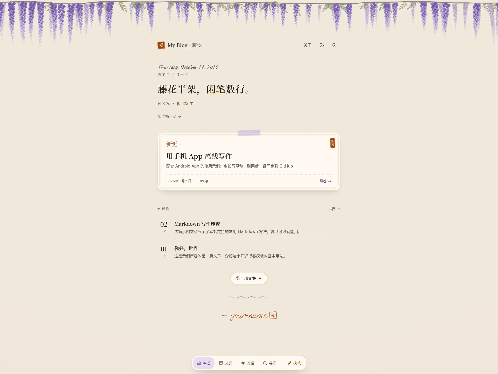
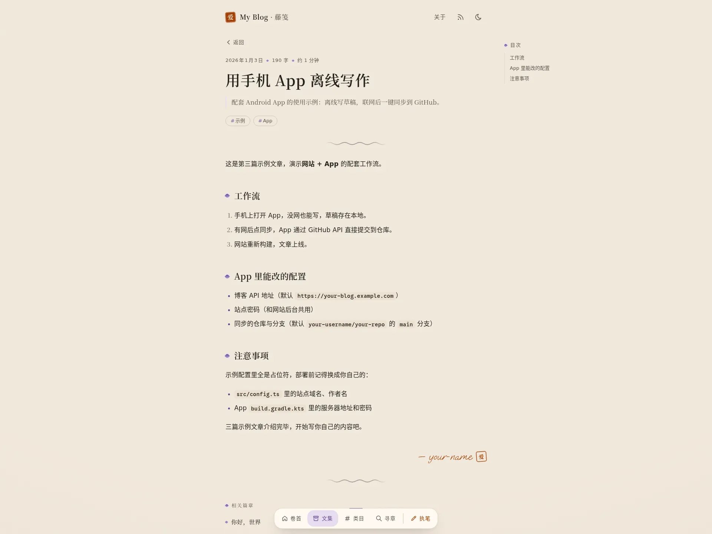

# Open Blog · 藤笺

一套完整的私人中文博客：**Astro 静态站 + Cloudflare Pages Functions（口令门、访客分站、在线写作台）+ Twikoo 评论（Cloudflare Workers + D1） + 原生 Android 离线写作 App**。

文章就是仓库里的 Markdown。电脑上 commit、网页写作台、手机 App 三种方式都能写，推到 `main` 就自动发布。

**在线预览：<https://open-blog-demo.pages.dev>**　口令 `demo`（故意输错可以体验访客分站）

| 首页 | 文章页 |
| ---- | ------ |
|  |  |

```text
open-blog/
├── web/       Astro 博客 + Pages Functions（部署到 Cloudflare Pages）
├── twikoo/    Twikoo 评论后端（Cloudflare Workers + D1 + R2）
└── android/   Android 写作 App（Java，无 WebView）
```

## 目录

- [特性](#特性)
- [它是怎么工作的](#它是怎么工作的)
- [本地开发](#本地开发)
- [部署教程](#部署教程)
  - [1. 准备仓库](#1-准备仓库)
  - [2. 修改站点配置](#2-修改站点配置)
  - [3. 创建 KV 命名空间](#3-创建-kv-命名空间)
  - [4. 创建 GitHub Token](#4-创建-github-token)
  - [5. 创建 Cloudflare Pages 项目](#5-创建-cloudflare-pages-项目)
  - [6. 绑定自定义域名](#6-绑定自定义域名)
  - [7. 验证](#7-验证)
- [评论（Twikoo）](#评论twikoo)
- [写文章](#写文章)
- [访客分站](#访客分站)
- [Android App](#android-app)
- [自定义外观](#自定义外观)
- [项目结构](#项目结构)
- [常见问题](#常见问题)

## 特性

**阅读**

- 「藤笺」视觉：暖米色信纸、紫藤横幅（浏览器里用 SVG 现场生成，地址加 `?seed=数字` 可复现同一架）、朱色印章、手写日期与农历
- 深色模式是暖褐色旧信纸；返回上一页或预渲染页面时主题保持同步
- 目次、阅读进度、字数与阅读时间、相关篇章与前后篇、随机一篇
- 标签、归档、Pagefind 全文搜索、RSS、OG 分享图
- 字体用 Fontsource 自托管，普通页面不请求 Google Fonts
- 单个换行按换行显示，与写作台预览一致

**私密与访问控制**

- 全站口令门：HMAC-SHA256 签名的会话 Cookie（HttpOnly、Secure、SameSite=Lax，30 天），所有页面 `noindex`
- 访客分站：口令输错不提示，直接进入一个独立构建的分站。分站没有写作台和管理接口，看不到被标记「对访客隐藏」的文章，评论区也不露出管理入口
- 限速：同一 IP 一小时内输错 5 次，之后 24 小时即使口令正确也只能进分站

**写作**

- `/desk/` 网页写作台：新建、编辑、删除文章，上传图片（自动转 WebP）与视频，切换「对访客隐藏」
- 通过 GitHub Contents API 直接改仓库，带 SHA 并发保护，保存即触发重新部署
- Android App：列表、阅读、写作全离线，联网后一键同步

**评论**

- Twikoo 客户端随仓库自带（`web/public/vendor/twikoo/`），同源加载，国内访问不依赖公共 CDN；加载失败才回退 jsDelivr / unpkg，全部带 SRI 校验
- 评论区滚动到文末附近才加载，不拖慢首屏
- 后端也在仓库里（`twikoo/`），部署到 Cloudflare Workers，数据存 D1，评论图片存 R2，和博客同一个 Cloudflare 账号就能跑，免费额度够用

## 它是怎么工作的

```text
            ┌───────────────────────── Cloudflare Pages ─────────────────────────┐
浏览器 ───▶ │ _middleware.js  口令正确 → 主站 dist/                               │
            │                 口令错误 → 访客分站 dist/__guest/（无写作台、无隐藏文章）│
            │ /desk/ 写作台 ─▶ /api/admin/* ─▶ GitHub API ─▶ 提交到仓库 ─▶ 自动重新构建 │
            └────────────────────────────────────────────────────────────────────┘
评论区 ───▶ Twikoo 客户端（同源） ───▶ https://twikoo.example.com（Workers + D1）
Android ──▶ /__auth 换 Cookie ──▶ /api/admin/articles?lite=1 增量同步
```

`pnpm build` 会跑两次 Astro 构建：一次主站，一次访客分站（`GUEST_BUILD=1`，排除 `src/data/guest-hidden.json` 里的文章），各自生成 Pagefind 索引。

## 本地开发

需要 Node.js 22.22 以上（`web/.node-version` 指定 24）和 pnpm。

```bash
cd web
pnpm install
pnpm dev        # http://localhost:4321
```

本地 `pnpm dev` 只跑 Astro，不执行 `functions/`，所以没有口令页，写作台接口也不可用。想在本地连 Functions 一起跑，构建后用 Wrangler：

```bash
pnpm build
npx wrangler pages dev dist --binding SITE_PASSWORD=demo --binding SESSION_SECRET=dev-secret
```

| 命令                  | 作用                                         |
| --------------------- | -------------------------------------------- |
| `pnpm dev`            | 本地开发                                     |
| `pnpm build`          | 构建主站与访客分站，并生成各自的搜索索引    |
| `pnpm preview`        | 预览构建产物（不含 Functions）               |
| `pnpm astro check`    | 类型与模板检查                               |
| `pnpm lint`           | ESLint                                       |
| `pnpm format`         | Prettier 格式化                              |

## 部署教程

以下以 Cloudflare Pages 为例，全程免费额度够用。

### 1. 准备仓库

Fork 本仓库，或者下载后推到你自己的 GitHub 仓库（公开、私有都可以）。下面用 `your-username/your-repo` 指代它。

### 2. 修改站点配置

编辑 `web/src/config.ts`：

```ts
export const SITE = {
  website: "https://your-blog.example.com", // 你的域名
  author: "your-name",                     // 作者名，也是文章 author 默认值
  profile: "https://your-blog.example.com",
  title: "My Blog · 藤笺",                  // 站点标题
  desc: "一座用 Astro 搭建的个人博客。",
  seal: "爱",                               // 印章上的字
  // ...
};
```

还要同步改这几处：

| 文件                                          | 改什么                                       |
| --------------------------------------------- | -------------------------------------------- |
| `web/src/components/Header.astro`             | 页眉品牌名 `My Blog`                         |
| `web/functions/_middleware.js`                | 口令页标题与落款（搜 `My Blog`、`your-name`） |
| `web/src/components/TwikooComments.astro`     | `ENV_ID` 换成你的评论后端地址（见下文）       |
| `web/src/pages/about.md`                      | 关于页                                       |
| `web/src/data/blog/`                          | 删掉示例文章，放你自己的                     |

### 3. 创建 KV 命名空间

KV 用来记录口令输错次数和锁定状态（键 `fail:<IP>:<小时>`、`lock:<IP>`，都会自动过期）。

Cloudflare 控制台 → **存储和数据库 → KV** → **创建命名空间**，名字随意，比如 `blog-auth`。

> 不绑 KV 站点也能用，只是没有限速；KV 出错时一律放行，不会把你锁在外面。

### 4. 创建 GitHub Token

写作台和 App 靠它读写仓库。

GitHub → Settings → Developer settings → **Fine-grained personal access tokens** → Generate new token：

- Repository access：**Only select repositories** → 选 `your-username/your-repo`
- Permissions → Repository permissions → **Contents: Read and write**

生成后复制保存，只显示一次。

### 5. 创建 Cloudflare Pages 项目

Cloudflare 控制台 → **Workers 和 Pages** → **创建** → **Pages** → **连接到 Git**，授权并选择你的仓库，然后：

| 设置项         | 值                |
| -------------- | ----------------- |
| 生产分支       | `main`            |
| 框架预设       | 无                |
| 构建命令       | `pnpm run build`  |
| 构建输出目录   | `dist`            |
| 根目录（高级） | `web`             |

在同一页的 **环境变量** 里添加（口令和密钥选「加密」）：

| 名称             | 必填 | 说明                                                       |
| ---------------- | ---- | ---------------------------------------------------------- |
| `SITE_PASSWORD`  | 是   | 访问口令，站点、写作台、App 共用                           |
| `SESSION_SECRET` | 是   | 会话签名密钥，用 `openssl rand -hex 32` 生成               |
| `GITHUB_TOKEN`   | 写作台需要 | 第 4 步的 Token                                      |
| `GITHUB_REPO`    | 写作台需要 | `your-username/your-repo`                            |
| `GITHUB_BRANCH`  | 否   | 写入的分支，默认用仓库默认分支                             |

点 **保存并部署**。首次构建约 2～3 分钟。

部署完成后，进入项目 → **设置 → 绑定** → **添加 → KV 命名空间**，变量名填 **`AUTH_BANS`**，选第 3 步创建的命名空间，然后在 **部署** 页对最新部署点「重试部署」让绑定生效。

> `SITE_PASSWORD` 或 `SESSION_SECRET` 没配时，站点会返回 503 “Authentication is not configured.”，这是故意的：宁可打不开，也不会裸奔。
>
> `web/wrangler.toml` 里的 KV 只是记录，Git 集成部署以控制台设置为准。

### 6. 绑定自定义域名

项目 → **自定义域** → **设置自定义域**，填 `your-blog.example.com`。域名在 Cloudflare 托管时会自动加 DNS 记录，否则按提示加一条 CNAME 指向 `<项目名>.pages.dev`。

### 7. 验证

1. 打开站点，应看到口令页
2. 输入正确口令 → 进入主站，Dock 里有「执笔」
3. 打开 `/desk/`，能列出文章；新建一篇保存，GitHub 仓库里出现新提交，几分钟后站点更新
4. 用无痕窗口输入错误口令 → 无提示进入访客分站，没有「执笔」，`/desk/` 返回 404

以后每次推送到 `main`（或在写作台保存），Cloudflare 都会自动重新构建。

## 评论（Twikoo）

评论分两半，都在本仓库里：

- **前端**：`web/public/vendor/twikoo/1.6.44/`（MIT 许可），由 `web/src/components/TwikooComments.astro` 加载，不用动
- **后端**：`twikoo/`，基于 [twikoo-cloudflare](https://github.com/twikoojs/twikoo-cloudflare)，跑在 Cloudflare Workers 上，评论存 D1 数据库，评论里上传的图片存 R2

冷启动不到 0.5 秒，Workers、D1、R2 的免费额度对个人博客绰绰有余。

### 部署后端

需要 Node.js 18+，在本机执行：

```bash
cd twikoo
npm install
npx wrangler login                     # 浏览器里授权你的 Cloudflare 账号
```

**1. 创建 D1 数据库并建表**

```bash
npx wrangler d1 create twikoo
```

把输出里的 `database_id` 填进 `twikoo/wrangler.toml`：

```toml
[[d1_databases]]
binding = "DB"
database_name = "twikoo"
database_id = "这里填输出的 id"
```

然后建表：

```bash
npm run db:init
```

**2. 创建 R2 存储桶（评论图片用）**

```bash
npx wrangler r2 bucket create twikoo
```

在 Cloudflare 控制台 → **R2** → `twikoo` 桶 → **设置** → **公开访问**，绑定一个自定义域（如 `twikoo-img.example.com`）或开启 `r2.dev` 子域，把这个地址填进 `wrangler.toml`：

```toml
[vars]
R2_PUBLIC_URL = "https://twikoo-img.example.com"
```

> 不打算让评论传图，这一步也可以照做但不绑域名，不影响文字评论。

**3. 部署**

```bash
npm run deploy
```

`deploy` 会先运行 `scripts/trim.mjs`，清空几个 Workers 里用不了的依赖入口，把包压到免费版 1 MiB 限制以内，再执行 `wrangler deploy --minify`。成功后会输出一个地址，例如：

```text
https://twikoo.<你的子域>.workers.dev
```

浏览器打开它，看到下面这行就说明后端正常：

```json
{"code":100,"message":"Twikoo 云函数运行正常……","version":"1.6.40"}
```

**4.（推荐）绑定自定义域名**

`workers.dev` 在国内经常连不上。控制台 → **Workers 和 Pages** → `twikoo` → **设置 → 域和路由** → **添加 → 自定义域**，填 `twikoo.example.com`（域名需托管在 Cloudflare）。

### 接到博客

编辑 `web/src/components/TwikooComments.astro`：

```js
const ENV_ID = "https://twikoo.example.com";
```

提交后等博客重新部署，打开任意一篇文章滚到底部，评论框就会出现。

### 设置管理员

1. 在主站打开一篇文章，评论区标题右侧点 **齿轮图标**
2. 首次进入会让你设置管理密码
3. 在「配置管理」里建议填写：
   - `SITE_NAME`、`SITE_URL`：站点名和地址
   - `BLOGGER_NICK`、`BLOGGER_EMAIL`：博主昵称和邮箱，用这个身份评论会带「博主」标记
   - `CORS_ALLOW_ORIGIN`：填你的博客域名，只允许自己的站点调用
   - 反垃圾：`AKISMET_KEY` 或敏感词、评论频率限制

访客分站里，齿轮和管理面板被隐藏了，访客即使把昵称填成你的名字也看不到；管理操作本身还需要管理密码。

### 邮件通知

Workers 不能直接走 SMTP，后端改用 HTTPS 邮件 API，支持 **SendGrid**、**MailChannels**、**Resend**。在管理面板「配置管理 → 邮件通知」里填：

| 配置项         | 填什么                                           |
| -------------- | ------------------------------------------------ |
| `SMTP_SERVICE` | `SendGrid`、`MailChannels` 或 `resend`           |
| `SMTP_USER`    | 随便填一个非空值                                 |
| `SMTP_PASS`    | 对应服务的 API Key                               |
| `SENDER_EMAIL` | 发件地址（需在该服务里验证过域名或地址）         |
| `SENDER_NAME`  | 发件人名称                                       |

填完点「发送测试邮件」确认能收到，并检查有没有进垃圾箱。

### 已知限制

Cloudflare Workers 只部分兼容 Node.js，所以这个后端：

- 不能用环境变量控制行为，所有设置都在管理面板里改
- 不显示评论者 IP 属地
- 用 `xss` 库做 XSS 过滤（代替 `dompurify`）
- 不会把 `/a/` 和 `/a` 视为同一页面；博客前端已统一去掉末尾斜杠，不受影响

### 升级

前后端版本尽量一致：

1. 后端：在 `twikoo/` 里 `npm install twikoo-func@<新版本>`，再 `npm run deploy`
2. 前端：下载同版本的 `twikoo.all.min.js`、`twikoo.css` 放进 `web/public/vendor/twikoo/<版本>/`，在 `TwikooComments.astro` 里更新路径、CDN 回退地址和两个 SRI 值（`openssl dgst -sha384 -binary 文件 | base64`）

## 写文章

### 方式一：直接写 Markdown

在 `web/src/data/blog/` 新建 `YYYY-MM-DD-标题.md`：

```yaml
---
title: 标题
description: 一句话简介
pubDatetime: 2026-01-01T09:00:00+08:00
tags: ["随笔"]
# pinned: true     # 置顶
# draft: true      # 草稿，不发布
---

正文……
```

完整字段参考 `web/src/content.config.ts` 和示例文章。图片放 `web/public/uploads/`，用 `/uploads/xxx.webp` 引用。

### 方式二：网页写作台

登录后打开 `/desk/`（或点 Dock 上的「执笔」）。可以新建、编辑、删除文章，粘贴或选择图片上传（图片 8MB、视频 25MB 以内，图片会转成 WebP），保存后自动提交到仓库。

### 方式三：Android App

见下文。

## 访客分站

想让输错口令的人看到一个“正常但不完整”的博客：

- 在写作台编辑文章时勾选 **「对访客隐藏」**，或者
- 手动把文章 slug（文件名去掉 `.md`）加进 `web/src/data/guest-hidden.json`：

```json
{
  "hidden": ["2026-01-03-mobile-writing"]
}
```

隐藏的文章在分站的列表、标签、归档、RSS、随机页、搜索索引和 OG 图里都不会出现。

## Android App

1. 编辑 `android/app/src/main/java/com/example/blog/net/Auth.java`：

   ```java
   public static final String SITE = "https://your-blog.example.com";
   public static final String SITE_PASSWORD = "your-site-password";
   ```

2. 构建（需要 JDK 17 和 Android SDK）：

   ```bash
   cd android
   ./gradlew assembleDebug
   # 产物：app/build/outputs/apk/debug/app-debug.apk
   ```

口令会打进 APK，**带真实口令的安装包不要公开发布**。App 用 `/__auth` 换会话 Cookie，再通过 `/api/admin/articles?lite=1` 增量同步，写操作带 `X-Blog-Request` 头。

## 自定义外观

- 颜色、字体、圆角、阴影：只在 `web/src/styles/tokens.css` 定义一次
- 口令页（`web/functions/_middleware.js`）和写作台（`web/public/desk/index.html`）是独立页面，各自顶部有一份令牌副本，改色时一并同步
- 深色模式令牌在同一文件的 `[data-theme="dark"]` 下

## 项目结构

```text
web/
├── functions/
│   ├── _middleware.js          口令门、会话、限速、访客分站分流
│   └── api/admin/
│       ├── _github.js          GitHub API 封装
│       ├── articles.js         文章列表、读取、保存、删除（?lite=1 供 App 同步）
│       ├── media.js            图片与视频上传
│       └── guest-hidden.js     对访客隐藏开关
├── public/
│   ├── desk/index.html         写作台
│   └── vendor/twikoo/          Twikoo 前端（同源托管）
├── scripts/build-guest.mjs     访客分站构建
├── src/
│   ├── components/             紫藤、Dock、目次、评论等
│   ├── layouts/ pages/ styles/ utils/
│   ├── data/blog/              文章
│   ├── data/guest-hidden.json  对访客隐藏的文章
│   ├── config.ts               站点配置
│   └── content.config.ts       frontmatter schema
└── wrangler.toml               KV 绑定记录
twikoo/
├── src/index.js                评论后端（Cloudflare Worker）
├── schema.sql                  D1 表结构
├── scripts/trim.mjs            部署前裁剪依赖体积
└── wrangler.toml               D1 / R2 绑定
android/                        写作 App
```

## 常见问题

**打开站点显示 503 “Authentication is not configured.”**
没配 `SITE_PASSWORD` 或 `SESSION_SECRET`。在 Pages 项目设置里加上后重新部署。

**写作台列表报错或保存失败**
检查 `GITHUB_TOKEN` 是否有该仓库的 Contents 读写权限、`GITHUB_REPO` 是否写对。

**正确口令也只能进访客分站**
同一 IP 一小时内输错了 5 次，被锁 24 小时。到 KV 里删掉 `lock:<你的IP>` 即可解除。

**评论区显示「留言板一时未能载入」**
检查 `ENV_ID` 地址能否在浏览器直接打开；`workers.dev` 在国内常被阻断，换成自定义域名。

**构建报 Node 版本错误**
Cloudflare 会读取 `web/.node-version`；自己构建时用 Node 22.22 以上。

## License

MIT。Twikoo 前端版权归 iMaeGoo（`web/public/vendor/twikoo/1.6.44/LICENSE`），`twikoo/` 后端来自 twikoo-cloudflare（Tao Xin、Mingy），均为 MIT 许可。
