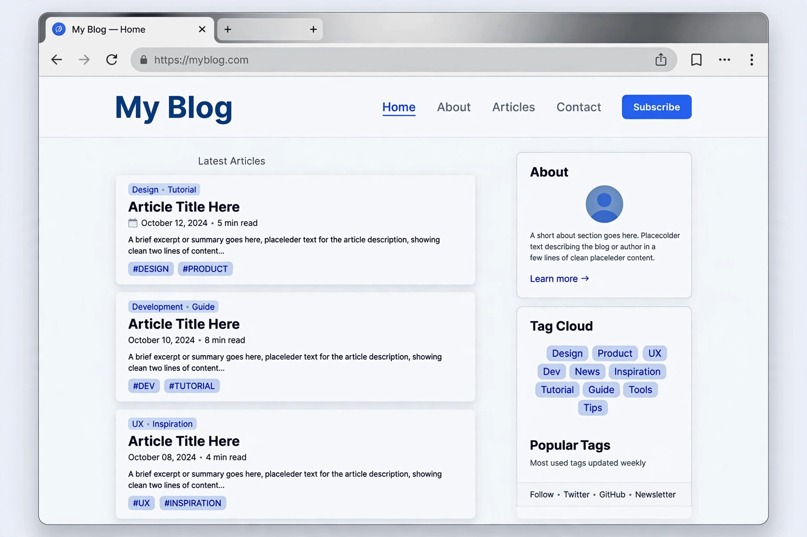

# Open Blog

个人博客完整方案：Astro 静态网站 + 原生 Android 离线写作 App。文章用 Markdown 写，网站静态生成，手机没网也能写草稿，联网后一键同步到 GitHub。



## 包含什么

```
open-blog/
├── web/        # Astro 博客网站（AstroPaper 主题改）
└── android/    # 原生 Android App（Kotlin，无 WebView）
```

- **web/**：Markdown 文章 → 静态页面，标签、搜索、评论（Twikoo）、明暗主题、RSS。
- **android/**：文章列表、阅读、写作全离线；写作支持标签与置顶；通过 GitHub API 直接提交同步。

## 快速开始

### 网站

```bash
cd web
pnpm install
pnpm dev        # 本地预览
pnpm build      # 构建到 dist/
```

部署到任意静态托管（Cloudflare Pages / Vercel / GitHub Pages 均可）。

### App

```bash
cd android
# 改 app/build.gradle.kts 里的服务器地址和密码
./gradlew assembleDebug
```

## 配置

网站配置在 `web/src/config.ts`：

```ts
// 换成你自己的
site: "https://your-blog.example.com",
author: "your-name",
```

App 配置在 `android/app/build.gradle.kts` 的 `buildConfigField`：博客地址、站点密码、同步仓库（默认 `your-username/your-repo` 的 `main` 分支）。

写文章：在 `web/src/data/blog/` 下新建 `YYYY-MM-DD-标题.md`，frontmatter 参考 `2026-01-01-hello-world.md`。

## 说明

- 示例配置全是占位符，部署前换成你自己的。
- 评论用 Twikoo，需自建 Twikoo 服务并改 `web/src/config.ts` 里的地址。

MIT License.
